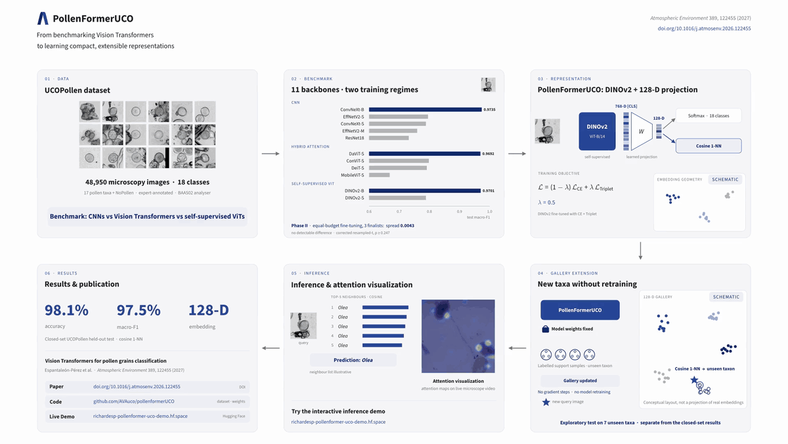
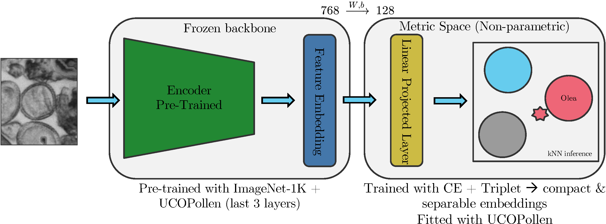
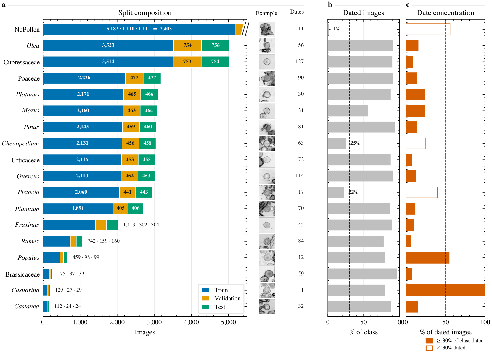

<div align="center">

# 🌾 PollenFormerUCO

### Vision Transformers for Pollen Grain Classification

#### A systematic backbone benchmark on **UCOPollen**

[](https://richardesp-pollenformer-uco-demo.hf.space/)
[](https://doi.org/10.1016/j.atmosenv.2026.122455)
[](#-license)


<br/>

<a href="https://richardesp-pollenformer-uco-demo.hf.space/">
  
</a>

<br/><br/>

<a href="static/pollenformer_abstract_poster.png">
  
</a>

<sub><b>Graphical abstract.</b> Click for the full-resolution poster.</sub>

</div>

---

## 🔬 Paper & live demo

This repository accompanies _“Vision Transformers for pollen grains classification: A systematic backbone benchmark on UCOPollen”_, accepted in
**Atmospheric Environment**, volume **389**, article **122455** (2027).
[Read the paper](https://doi.org/10.1016/j.atmosenv.2026.122455).

A **fully interactive live demo of the trained model is online** — no installation, no setup:

<div align="center">

### 👉 **[richardesp-pollenformer-uco-demo.hf.space](https://richardesp-pollenformer-uco-demo.hf.space/)**

</div>

In the demo you can:

- 🖼️ **Upload a microscopy image** (JPG / PNG / WEBP / BMP) or pick a bundled sample.
- 🏷️ Get the **predicted pollen taxon** with a confidence indicator.
- 🤝 Inspect the **top-k nearest neighbours** (with cosine similarity) used for k-NN inference.

> 📦 The Space hosts the online demo only. The code lives in this repository, which also releases the
> trained weights and the k-NN reference gallery: see [Code, weights & dataset](#-code-weights--dataset).

---

## 🧩 What this project offers

- **UCOPollen:** 48,950 expert-annotated microscopy images covering 17 pollen taxa and a NoPollen class.
- **PollenFormerUCO:** a fine-tuned DINOv2-ViT Base model for classification and reference-image retrieval
  through a compact 128-D embedding.
- **A controlled benchmark:** eleven backbones compared across training regimes. The
  [paper](https://doi.org/10.1016/j.atmosenv.2026.122455) reports the experiments, statistical
  comparisons and detailed analysis.

---

## 🧠 Method & architecture

PollenFormerUCO fine-tunes a self-supervised **DINOv2-ViT Base** backbone with a linear
projection (768 → **128-D**) under a **hybrid Cross-Entropy + Triplet** objective.

**Microscopy image → DINOv2 backbone → 128-D embedding → cosine nearest neighbours → pollen taxon.**

The deployed model compares each query with a gallery of labelled reference embeddings and returns
both a prediction and the closest reference images. A **softmax head** provides an alternative
readout for the original training classes. New taxa can be introduced by adding labelled examples
to the gallery without retraining the model; the paper evaluates this on seven previously unseen taxa.

<div align="center">

</div>

---

## 📊 Dataset — UCOPollen v1.0

UCOPollen contains **48,950 expert-annotated microscopy images** spanning **17 pollen taxa** plus a
**NoPollen** negative class, provided by the Department of Botany, Ecology and Plant Physiology at
the University of Córdoba. Images were acquired with a **BAA502 (POMO) automatic bioaerosol analyser**.
The stratified **70 / 15 / 15** train / validation / test split contains **34,257 / 7,335 / 7,358 images**.

<div align="center">
<a href="static/dataset_acquisition.pdf">
  
</a>
<br/>
<sub>UCOPollen composition and acquisition concentration. Click the figure to open the vector PDF.</sub>
</div>

**Reading the figure.** Classes are ordered by image count. **(a)** Train, validation and test
counts, one representative image per class, and the number of distinct acquisition dates;
the NoPollen bar is broken at 5,500 images and labels its full total of 7,403.
**(b)** Percentage of each class with a recovered acquisition timestamp.
**(c)** Percentage of dated images contributed by the largest single acquisition date;
outlined bars indicate classes with less than 30% timestamp coverage.

Acquisition timestamps are available for **65.9%** of the images. The stratified split shares
acquisition dates across subsets, although no image appears in more than one subset. The paper
therefore includes a separate **date-disjoint evaluation (Phase III)** to assess robustness to
held-out acquisition dates.

<sub>Figure reproduced from the <a href="https://doi.org/10.1016/j.atmosenv.2026.122455">paper by Espantaleón-Pérez et al.</a>, licensed under <a href="https://creativecommons.org/licenses/by-nc/4.0/">CC BY-NC 4.0</a>.</sub>

<div align="center">

|              |          |           |             |              |            |
| ------------ | -------- | --------- | ----------- | ------------ | ---------- |
| Brassicaceae | Castanea | Casuarina | Chenopodium | Cupressaceae | Fraxinus   |
| Morus        | Olea     | Pinus     | Pistacia    | Plantago     | Platanus   |
| Poaceae      | Populus  | Quercus   | Rumex       | Urticaceae   | _NoPollen_ |

</div>

> 🔒 Public release of the UCOPollen dataset is pending. Its download link will be added here when available.

---

## ✨ Results at a glance

**PollenFormerUCO on the stratified UCOPollen test split** (17 pollen taxa + NoPollen):

| Inference method                  | Test accuracy | Macro-F1  |
| --------------------------------- | :-----------: | :-------: |
| Softmax head                      |     97.7%     |   97.1%   |
| **Cosine 1-NN (128-D embedding)** |   **98.1%**   | **97.5%** |

These results describe the image-level split. The separate, post hoc date-disjoint evaluation
reports **96.1% accuracy / 88.6% macro-F1 over 17 classes**, using the subset with acquisition
metadata and excluding Casuarina. See the [paper](https://doi.org/10.1016/j.atmosenv.2026.122455)
for protocols, per-class results, ablations and statistical comparisons.

---

## ⚖️ Strengths & limitations

### Strengths

- **Expert-labelled reference data.** A curated dataset with class examples, fixed evaluation splits
  and recovered acquisition metadata supports benchmarking for Mediterranean pollen recognition.
- **Compact, reusable representation.** A 128-D embedding supports classification and retrieval
  of reference images with a simple cosine nearest-neighbour rule.
- **Gallery extension.** Labelled examples can add new taxa without retraining; the study demonstrates
  this capability for morphologically distinctive taxa on the same imaging device.

### Limitations

- **External validation is still needed.** Data come from one institution and one imaging device.
  Performance across devices, regions and acquisition conditions has not been established.
- **Acquisition context and class imbalance matter.** The image-level split shares acquisition dates
  across subsets; timestamps cover only 65.9% of images. Rare and morphologically similar taxa
  remain challenging, and the date-disjoint analysis does not cover the full dataset.
- **Unknown-class rejection is not calibrated.** Unseen taxa similar to known classes can receive
  confident incorrect assignments. Gallery-extension experiments are small and preliminary;
  reliable unattended operation requires further validation and a dedicated rejection mechanism.

For the supporting evidence and full discussion, read the
[paper](https://doi.org/10.1016/j.atmosenv.2026.122455).

---

## 📦 Code, weights & dataset

This GitHub repository is the official home of PollenFormerUCO. The release is organised so that a
researcher can clone the project and run a real prediction without training the model from scratch.

| Component                                             | Where                                                                    | Status            |
| ----------------------------------------------------- | ------------------------------------------------------------------------ | ----------------- |
| Model, k-NN inference and command line                | [`src/pollenformer/`](src/pollenformer)                                  | ✅ Available      |
| Streamlit demo (deployed to the Space)                | [`demo/`](demo)                                                          | ✅ Available      |
| Trained weights and k-NN gallery (embeddings, labels) | Release `v0.1.0`, checked by SHA-256 on download                         | ⏳ Pending upload |
| Training and evaluation code                          | This repository                                                          | ⏳ Pending        |
| UCOPollen dataset                                     | Released with its own license                                            | ⏳ Pending        |
| Live demo                                             | [Hugging Face Space](https://richardesp-pollenformer-uco-demo.hf.space/) | ✅ Available      |

Links will be added here as each component is released.

---

## 🚀 Quickstart

Requires [mise](https://mise.jdx.dev), which installs [uv](https://docs.astral.sh/uv); uv then
provides the Python version in [`.python-version`](.python-version) and the locked dependencies.

```bash
git clone https://github.com/AVAuco/pollenformerUCO && cd pollenformerUCO
mise trust && mise install  # pinned tools: uv and gitleaks
mise run setup:uv-env       # .venv from uv.lock, plus the git hooks
mise run artifacts:fetch    # model + gallery, verified by SHA-256 (~365 MB, cached)

uv run pollenformer predict demo/demo_samples/castanea.png   # JSON: taxon + neighbours
mise run app:demo:soft      # Streamlit demo on localhost:8501 (app:demo:hard: expert mode)
```

`uv` must be the version mise pins: activate mise in your shell, or prefix the command with
`mise exec --`. The package also installs with plain pip: `pip install .` (add `.[demo]` for the
Streamlit app). [demo/README.md](demo/README.md) covers the settings, local copies of the
artifacts and the Docker image of the demo.

---

## 🛠️ Development

[`pyproject.toml`](pyproject.toml) holds the package metadata and every quality rule,
[mise](mise.toml) is the command interface (`mise tasks` lists every workflow), and
[pre-commit](.pre-commit-config.yaml) is the single source of truth for linting and formatting.
GitHub Actions runs the same mise tasks, and `mise run ci:check` runs that gate locally:

- **Ruff** formats and lints with an 88-character limit, Google docstrings, complexity ≤ 10 and
  security rules.
- **import-linter** enforces layered imports, which rules out circular dependencies, and keeps
  the package free of the demo's UI libraries.
- **pytest** runs the unit tests with branch coverage of at least 90%. They need neither the
  network nor the artifacts; `mise run test:e2e` adds end-to-end checks with the real model.
- **gitleaks** scans the staged changes on every commit and the whole history in CI.

Read [CONTRIBUTING.md](CONTRIBUTING.md) before opening a pull request, and
[demo/README.md](demo/README.md) for the environment, the configuration and every mise task.

---

## 📚 Citation

If you use PollenFormerUCO, UCOPollen, or this benchmark in your research, please cite
the [paper](https://doi.org/10.1016/j.atmosenv.2026.122455):

```bibtex
@article{EspantaleonPerez2027PollenFormerUCO,
  author  = {Espantale{\'o}n-P{\'e}rez, Ricardo and Farooq, Qasim and L{\'o}pez-Orozco, Roc{\'i}o and Gonz{\'a}lez-Alonso, M{\'o}nica and Alashhab, Samer and Oteros, Jose and Buters, Jeroen and Gal{\'a}n, Carmen and Mar{\'i}n-Jim{\'e}nez, Manuel J.},
  title   = {{Vision Transformers} for pollen grains classification: A systematic backbone benchmark on {UCOPollen}},
  journal = {Atmospheric Environment},
  volume  = {389},
  pages   = {122455},
  year    = {2027},
  issn    = {1352-2310},
  doi     = {10.1016/j.atmosenv.2026.122455},
  url     = {https://www.sciencedirect.com/science/article/pii/S1352231026006850}
}
```

---

## 👥 Authors

Ricardo Espantaleón-Pérez<sup>1</sup>, Qasim Farooq<sup>4,5</sup>,
Rocío López-Orozco<sup>4,5</sup>, Mónica González-Alonso<sup>3</sup>,
Samer Alashhab<sup>3</sup>, Jose Oteros<sup>4,5</sup>, Jeroen Buters<sup>3</sup>,
Carmen Galán<sup>4,5</sup>, and Manuel J. Marín-Jiménez<sup>1,2</sup>.

1. Department of Computer Science and Artificial Intelligence, University of Córdoba (UCO), Córdoba, Spain.
2. Maimonides Institute for Biomedical Research of Córdoba (IMIBIC), Córdoba, Spain.
3. Center of Allergy & Environment (ZAUM), Member of the German Center for Lung Research (DZL), Technische Universität München/Helmholtz Center, Munich, Germany.
4. Department of Botany, Ecology and Plant Physiology, Agrifood Campus of International Excellence (ceiA3), University of Córdoba, Rabanales Campus, Celestino Mutis Building, Córdoba, Spain.
5. Andalusian Inter-University Institute for Earth System Research (IISTA), University of Córdoba, Córdoba, Spain.

---

## 📄 License

The source code of PollenFormerUCO is released under the [MIT License](LICENSE).

The [article](https://doi.org/10.1016/j.atmosenv.2026.122455) is published open access under
[CC BY-NC 4.0](https://creativecommons.org/licenses/by-nc/4.0/); figures reproduced from it in this
README are shared under the same license.

Model weights and the UCOPollen dataset are subject to their respective licensing terms, documented
alongside their releases.

If you use this work in your research, please cite the [associated publication](#-citation).
